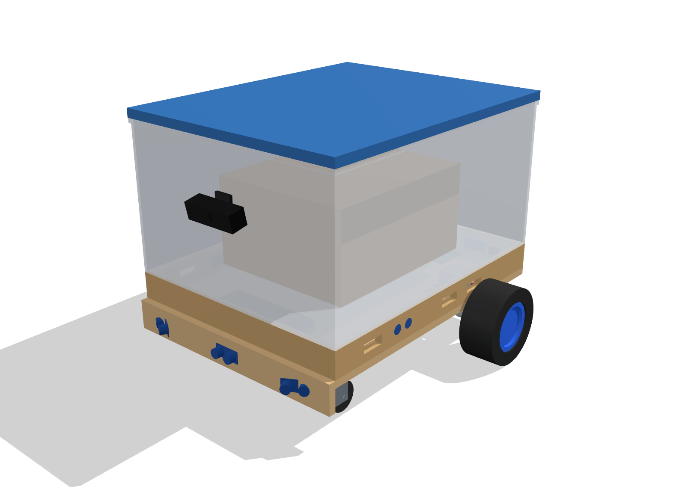

# Delivery rover: 3D model and build pack

A self-driving delivery rover that carries a 5 kg package. The storage box is the whole body, the electronics sit in a closed compartment underneath it, and the phone inside runs the self-driving app in this repository.



| | |
|---|---|
| Size (length × width × height) | 549 × 530 × 415 mm |
| Mass, empty / with a 5 kg package | 6.1 kg / 11.1 kg |
| Drive | 2 × JGB37-520 60 RPM motors with Hall encoders, 130 mm wheels, 2 swivel casters at the front |
| Speed | 0.41 m/s |
| Sensors | phone (GPS, compass, IMU), USB webcam, 7 × HC-SR04 ultrasonic (front, sides, rear) |
| Power | 3S2P 18650 pack (11.1 V, about 55 Wh) |

## Documents

- [Build pack (PDF)](docs/delivery_rover_build_pack.pdf): renders, dimensioned drawings, ultrasonic coverage, plywood cut plan, drilling template, materials, wiring and ESP32 pin map, assembly steps, weight and balance.
- [Parts list (PDF)](docs/delivery_rover_BOM.pdf): every part with Sri Lankan shop links and prices, fasteners and tools.
- [3D viewer](docs/rover_viewer.html): download the file and open it in a browser to turn the model, hide the box and click parts. It loads three.js from the internet.

## 3D files

| File | Open with |
|---|---|
| [model/delivery_rover.step](model/delivery_rover.step) | Fusion 360, SolidWorks, Onshape, FreeCAD (solids, every part named) |
| [model/delivery_rover.FCStd](model/delivery_rover.FCStd) | FreeCAD |
| [model/delivery_rover.glb](model/delivery_rover.glb) | Blender, Windows 3D Viewer, GitHub's file preview (coloured) |
| [model/delivery_rover.stl](model/delivery_rover.stl) | Mesh tools and slicers (one mesh) |

All sizes are in millimetres. Axes: x forward, y to the rover's left, z up, origin on the ground under the centre of the deck.

## Rebuilding

The model is code, so you can change a size in `src/build_model.py` and rebuild everything:

```bash
/Applications/FreeCAD.app/Contents/Resources/bin/freecadcmd src/build_model.py   # STEP, STL, FCStd, build/mesh.json
python3 src/make_glb.py        # coloured GLB and the browser viewer
python3 src/make_drawings.py   # dimensioned drawings and the weight and balance numbers
python3 src/make_pdf.py        # build pack PDF (needs Brave or Chrome; set the path at the bottom of the script)
python3 src/make_bom_pdf.py    # parts list PDF
```

The 3D pictures in `docs/img/render_*.png` are screenshots of `docs/rover_viewer.html?shot=1&view=iso` taken with a headless browser.

Three sizes are typical values, not measured: the 37 mm motor bracket, the 2" caster height and the webcam. Check yours. The riser under each caster is 93 mm minus the caster's height.
